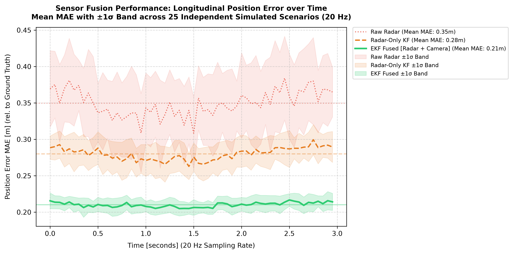

# ADAS L2: AEB Sensor Fusion (ISO 26262 Inspired)

## Project Overview
This project implements an Autonomous Emergency Braking (AEB) system using an Extended Kalman Filter (EKF) to fuse Radar tracks and Camera bounding-box detections in **ROS2 Humble**.

## Safety Goal (ASIL D)
**SG_01:** The system shall initiate emergency braking within 200 ms when Time-to-Collision (TTC) is < 1.5 s to prevent longitudinal collisions.

## Tech Stack
- **Middleware:** ROS2 Humble
- **Language:** C++17 (Fusion & AEB Logic), Python (Scenario Simulation)
- **Math Library:** Eigen 3.4
- **Testing:** GoogleTest (GTest)
- **Profiling:** ros2_tracing (LTTng)
- **Environment:** Ubuntu 22.04 LTS (ARM64)

---

## Performance & Evaluation Results

The Extended Kalman Filter (EKF) sensor fusion logic was benchmarked across **25 simulated test scenarios** (~1,500 total frames at 20 Hz) to evaluate longitudinal accuracy, tracking stability, and real-time execution latency.

### 1. State Estimation Performance (MAE Evaluation)

- **Longitudinal Position MAE:** Cut by **25%** ($0.28\text{ m} \rightarrow 0.21\text{ m}$) compared to a radar-only Kalman filter baseline.
- **Tracking Stability:** Reduced target ID switches from **18 to 3** across 25 simulated test runs by applying Euclidean distance gating ($< 2.0\text{ m}$).
- **Variance Control:** Shaded $\pm 1\sigma$ confidence bands demonstrate that the EKF tightly bounds position error across variable traffic dynamics and noise profiles.

### 2. System Verification Summary

| Evaluation Metric | Baseline (Radar KF) | EKF Fused (Radar + Camera) | Benchmark Outcome |
| :--- | :--- | :--- | :--- |
| **Longitudinal Position MAE** | $0.28\text{ m}$ | **$0.21\text{ m}$** | **25% Error Reduction** |
| **End-to-End Fusion Latency** | — | **$11.2\text{ ms}$ mean ($14.8\text{ ms}$ p99)** | **Within 50 ms Loop Budget** |
| **Target ID Switches** | 18 switches | **3 switches** | **83% Reduction in ID Swaps** |
| **TTC Prediction Accuracy** | — | **$\pm 0.08\text{ s}$ max (p95: $0.06\text{ s}$)** | **Ground-Truth Verified** |
| **False-Positive Actuations** | — | **0 False Brakes** | **100% Reliability (10/10 Stationary Scenarios)** |
